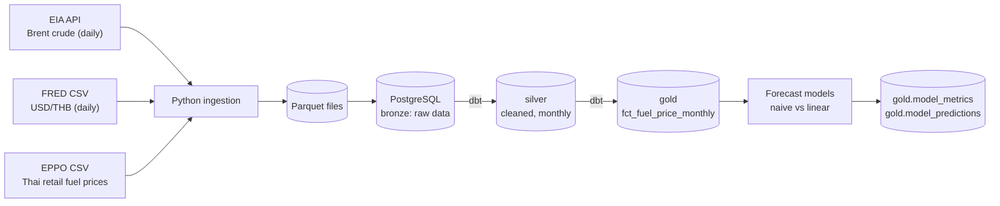
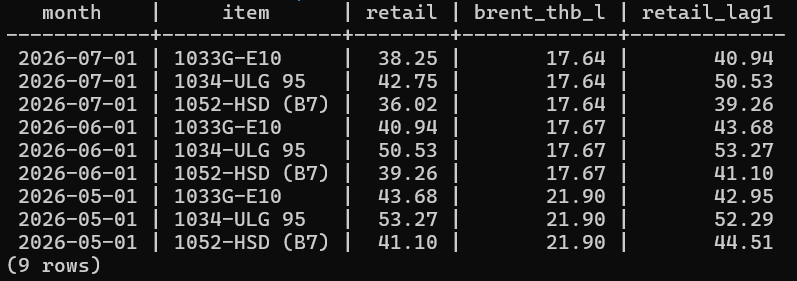

# Thailand Fuel Price Intelligence


## Overview

This project aims to collect raw data from 3 public sources (Brent crude prices, USD/THB exchange rates, and Thai retail fuel prices), then clean and combine them into one monthly table using Python, PostgreSQL, dbt, and Docker. A model trained on the cleaned data then forecasts fuel prices one month ahead. A linear model using lagged Brent prices reduced the mean absolute error by about 10-16% against a naive baseline for gasoline grades (E10 and gasoline 95), with no improvement for diesel.

## Architecture

The architecture used in this project is an ELT design with Medallion layers (Bronze → Silver → Gold):

- **Extract:** Data is pulled from 3 public sources.
- **Load:** The raw data is loaded into PostgreSQL (Bronze).
- **Transform:** dbt cleans and combines the data inside the database (Silver → Gold).



## Data sources

- **U.S. EIA Open Data API:** Brent spot prices (series `RBRTE`, USD per barrel), daily, accessed through the API with a free key.
- **FRED (Federal Reserve H.10, series `DEXTHUS`):** Thai baht per 1 US dollar, daily, downloaded as CSV.
- **EPPO Government Data Catalog:** Retail fuel prices from many countries, filtered to Thailand (E10 gasohol, gasoline 95, diesel B7), downloaded as CSV. The data is monthly in earlier years and weekly in recent years.

The sources have different frequencies (daily, weekly, and monthly), so all of them are averaged to monthly in the Silver layer before being combined.


## Pipeline layers

- **Bronze:** Raw data is loaded into PostgreSQL as received, with a `loaded_at` timestamp added. Each load replaces the whole table (Brent 9,999 rows, USD/THB about 11,941 rows, EPPO 29,293 rows covering many countries).
- **Silver:** dbt keeps Thai rows only, removes null values, and averages every source to monthly (Brent 474 months, USD/THB 550 months, Thai fuel prices 525 rows: 3 fuel types x 175 months).
- **Gold:** dbt joins the three monthly tables on `month` into `fct_fuel_price_monthly` (525 rows, 2012-01 to 2026-07). Brent is converted to THB per litre (USD per barrel x USD/THB / 158.987), and 1-3 month lagged features are added for forecasting.



## Data quality

- **Automated tests:** 14 dbt tests run on the Silver and Gold layers. They check that key columns are not null, that months are unique in the Brent and USD/THB tables, and that fuel type is one of the three expected values. All pass.
- **Manual checks:** The first Brent pull returned exactly 5,000 rows, so I suspected the API had truncated the data. I added pagination and fetched page by page, which returned about 10,000 rows.
- **Known gaps:** Passing tests does not guarantee the data is correct, because tests only check the rules I have written.


## Results

- **Pipeline output:** The Gold table `fct_fuel_price_monthly` has 525 rows (3 fuel types x 175 months, 2012-01 to 2026-07) and is ready to be used for forecasting.
- **Forecast accuracy:** One-month-ahead forecasts were evaluated on the most recent 24 months (THB per litre, lower is better). The Brent-based linear model improved both gasoline grades, while diesel was about the same as the baseline.

| Fuel | Naive MAE | Linear MAE | Naive RMSE | Linear RMSE |
|---|---|---|---|---|
| E10 gasohol | 1.172 | 0.980 | 2.289 | 1.733 |
| Gasoline 95 | 1.432 | 1.289 | 2.856 | 2.168 |
| Diesel B7 | 1.086 | 1.102 | 2.804 | 2.479 |

- **Main finding:** In April 2026, all three fuels rose by roughly 10 THB per litre within one month, and the model did not anticipate it.


## Limitations

**Forecasting**

- The test set is only the most recent 24 months per fuel type, from a single time-based split, so the error metrics are noisy.
- Diesel MAE is about the same as the naive baseline (1.102 vs 1.086 THB per litre), so the model shows no clear improvement for diesel.
- Most of the error comes from April 2026, when all three fuels rose by roughly 10 THB per litre in one month. A linear model based on lagged Brent prices under-reacts to a shock of this size. The underlying cause was not investigated.
- The models were not tuned after looking at the errors, to avoid evaluating redesigned features on the same test period.

**Pipeline**
- The pipeline runs with a single command (`python run_pipeline.py`), but there is no scheduler, so it is started manually.
- Loads are full refreshes (tables are overwritten), not incremental.
- The data volume is small (about 51,000 raw rows), so performance at larger scale has not been tested.
- The EPPO data is monthly in earlier years and weekly in recent years, so the monthly averages are built from different numbers of observations.
- There is no CI/CD, no data freshness monitoring, and no value-range tests (for example, that prices are positive).


## How to run

**Requirements:** Docker Desktop, Python 3.11, and a free EIA API key (https://www.eia.gov/opendata/register.php).

Run all commands from the project root.

1. **Set up the environment file.** Copy `.env.example` to `.env` and fill in the values (this file is git-ignored and must never be committed).

```powershell
   Copy-Item .env.example .env
```

2. **Start PostgreSQL** (bound to `127.0.0.1:5434`).

```powershell
   docker compose up -d
```

3. **Create a virtual environment and install dependencies.**

```powershell
   python -m venv .venv
   .venv\Scripts\activate
   pip install -r requirements.txt
```
**Quick start:** after steps 1-3, run the whole pipeline with one command. It starts PostgreSQL, ingests, loads, runs dbt and its tests, and trains the models (about 3 minutes):

```powershell
python run_pipeline.py
```

Steps 4-7 show the same pipeline step by step.

4. **Ingest the raw data** (saved as Parquet files in `data/bronze/`).

```powershell
   python ingestion/fetch_brent.py
   python ingestion/fetch_usdthb.py
   python ingestion/fetch_thai_fuel.py
```

5. **Load into PostgreSQL** (Bronze layer).

```powershell
   python ingestion/load_to_postgres.py
```

6. **Transform and test with dbt** (runs in Docker; the first run builds the image and takes a few minutes).

```powershell
   docker compose run --rm dbt run --profiles-dir .
   docker compose run --rm dbt test --profiles-dir .
```

   Expected result: 4 tables created (3 Silver, 1 Gold) and all 14 tests pass.

7. **Train and evaluate the forecasting models.**

```powershell
   python ml/train_models.py
```

   Results are written to `gold.model_metrics` and `gold.model_predictions`.